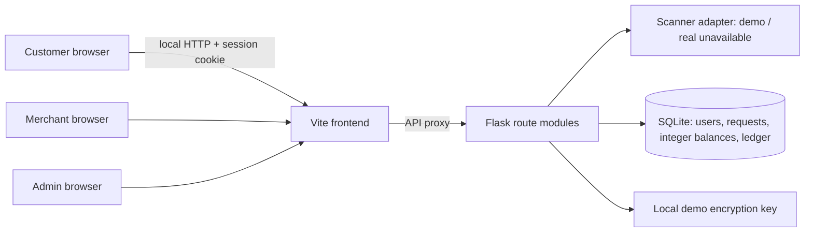

# PalmPay — local educational demo

**Do not use real money or real biometric data.** The online version is a demo deployment with fake data only (see "Online demo deployment" below); do not share its demo passwords publicly. Scans, top-ups and payouts are simulated; demo controls can impersonate a customer. This is a capstone prototype, not production payment software. See `IMPLEMENTATION_STATUS.md` for a numbered, honest status of all 32 requirements and remaining gaps.

## Run on Windows

Install Python 3.10+ with the Python launcher (`py`) and Node.js 18+ first. Extract the ZIP and open the `palmpay` folder. Double-click `start-demo.bat`, or run it from Command Prompt. It installs dependencies, opens backend and frontend windows, and displays the address `http://localhost:5173`. Wait a few seconds before opening the address. Leave both windows running; close them to stop. The launcher handles paths with spaces but has not been tested on an actual Windows PC in this environment.

If the launcher fails, open two Command Prompt terminals inside the project folder. In the first:

```bat
cd server
py -m venv venv
venv\Scripts\activate.bat
python -m pip install -r requirements.txt
python app.py
```

In the second:

```bat
cd client
npm ci
npm run dev
```

Then open `http://localhost:5173`. Install packages with an internet connection. If `py` is unavailable, try `python`. If ports 5000 or 5173 are busy, stop the other program first. The browser and both services must run on the same computer for this demo.

## Accounts

| Role | Email | Password |
|---|---|---|
| Admin | admin@palmpay.com | Admin@123 |
| Merchant | shop@palmpay.com | Shop@123 |
| Customer | rahim@palmpay.com | Rahim@123 |

Rahim has a starting demo balance of ৳5,000, synthetic enrolled palm, and PIN `1234`. New merchant accounts need approval under Admin → Users & Merchants. Passwords and one-click demo login are public; never use these credentials in a real service.

## Try the approval feature

Open two separate browser sessions (normal and private windows), both connected to the same local app. Sign in as Rahim in one and as merchant in the other. Merchant selects Rahim and enters ৳1,200 and a description, selects **Force Success**, and confirms. Rahim receives a request on the customer screen. If he agrees, he shares the six-digit code with the merchant, who enters it within two minutes. Three wrong codes, expiry, or Decline cancels the request without a charge. Both screens show completion. The merchant can print a receipt.

By default a payment of ৳1,000 or less completes after a simulated scan; higher amounts require the code. Admin → Settings & alerts can change the threshold and spending limits. This per-payment threshold can be bypassed by splitting charges and is not a complete fraud control. For PIN fallback, simulate a failed scan, click **Request customer PIN fallback**, then enter the PIN on the customer's screen; a large payment also needs the code. Three failed scans lock the account; an admin can unlock it in Settings & alerts.

Merchant history supports full simulated refunds; unpaid bills can be cancelled. Balance & payouts simulates payouts, without moving real funds. Admin Reports offers date filters and CSV export. Bengali currently translates navigation only.

## Tests and backup

From a Command Prompt in the project folder:

```bat
cd server
venv\Scripts\activate.bat
python -m unittest discover -s tests -v
```

Before using an existing database, make a copy. Migration hashes old plaintext PINs, encrypts old plaintext demo templates, adds integer-poisha balances, and records current balances as opening entries; it does not reconstruct historical ledger entries. Back up `server/palmpay.db` **and** `server/.demo_key` together; without the original key, encrypted templates cannot be recovered. Keep both private. Admin → Settings & alerts includes a confirmation-protected local reset that permanently deletes all demo records, including the ledger, and recreates demo accounts. All sessions are invalidated.

## Architecture diagram



## Payment-flow diagram


## Security and delivery boundaries

Real mode deliberately fails closed until an actual scanner is integrated and validated. No liveness detection, secure hardware, real payment provider, production deployment or independent security audit is included. The local key, demo credentials, SQLite and development servers are unsuitable for public deployment. Further work is needed on full Bangla translation, mobile polish, notifications and safe deployment; see the checklist.

## If payment returns “Request failed (500)” on Windows

Make sure the backend is using the project virtual environment and its dependencies are installed, including `tzdata`. In the `server` folder run:

```bat
venv\Scripts\python.exe -m pip install -r requirements.txt
venv\Scripts\python.exe app.py
```

Restart any running backend first (Ctrl+C). If an error persists, inspect the traceback in the PalmPay API window. Do not post passwords, PINs or approval codes.


## Online demo deployment (Render)

The Flask server also serves the built React app, so one URL opens the whole software.

- `render.yaml` and `build.sh` describe the Render web service (build the frontend, install backend, start with gunicorn).
- `.github/workflows/ci.yml` runs backend tests, frontend tests and the frontend build on every push.
- Live URL: _add your Render link here after deploying_
- Free hosting sleeps when idle (first load can take about a minute) and resets the database on restart; demo accounts are re-created automatically.
- Local run is unchanged: `start-demo.bat`.

## Online demo deployment (Render)
...
- Live URL: - Live URL: https://palmpay-gfmm.onrender.com
