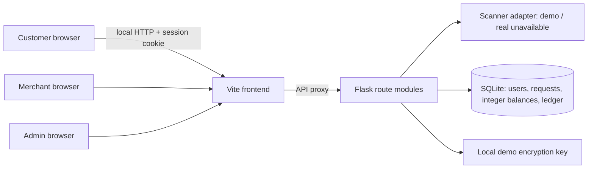
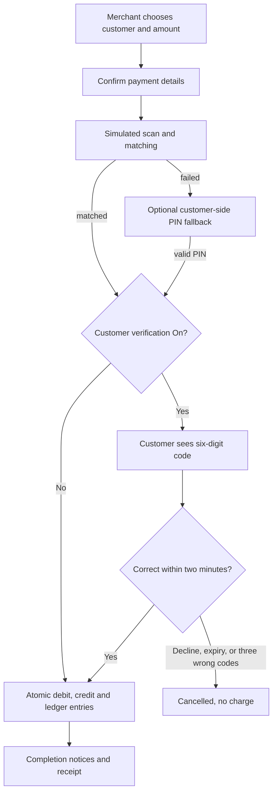

# PalmPay — local educational demo

**Do not use real money or real biometric data, and do not deploy this build publicly.** Scans, top-ups and payouts are simulated; demo controls can impersonate a customer. This is a capstone prototype, not production payment software. See `IMPLEMENTATION_STATUS.md` for a numbered, honest status of all 32 requirements and remaining gaps.

## Run on Windows

Install Python 3.10+ with the Python launcher (`py`) and Node.js 18+ first. Extract the ZIP and open the `palmpay` folder. Double-click `start-demo.bat`, or run it from Command Prompt. It installs dependencies, opens backend and frontend windows, and displays the address `http://localhost:5173`. Wait a few seconds before opening the address. Leave both windows running; close them to stop. The launcher handles paths with spaces but has not been tested on an actual Windows PC in this environment.

If the launcher fails, open two Command Prompt terminals inside the project folder. In the first:

```bat
cd server
py -m venv venv
venv\Scripts\activate.bat
python -m pip install -r requirements.txt
python app.py
```

In the second:

```bat
cd client
npm ci
npm run dev
```

Then open `http://localhost:5173`. Install packages with an internet connection. If `py` is unavailable, try `python`. If ports 5000 or 5173 are busy, stop the other program first. The browser and both services must run on the same computer for this demo.

## Accounts

| Role | Email | Password |
|---|---|---|
| Admin | admin@palmpay.com | Admin@123 |
| Merchant | shop@palmpay.com | Shop@123 |
| Customer | rahim@palmpay.com | Rahim@123 |
| Customer | ayesha@palmpay.com | Demo@123 |
| Customer | karim@palmpay.com | Demo@123 |
| Merchant | dhanmondi@palmpay.com | Demo@123 |
| Merchant | gulshan@palmpay.com | Demo@123 |
| Merchant | mirpur@palmpay.com | Demo@123 |
| Merchant | uttara@palmpay.com | Demo@123 |

Rahim has a starting demo balance of ৳5,000. Ayesha and Karim have ৳3,000 each. All three have synthetic enrolled palms and demo PIN `1234`. New merchant accounts need approval under Admin → Users & Merchants. Passwords and one-click demo login are public; never use these credentials in a real service.

## Admin: demo devices and editing profiles

A fresh install creates 3 demo customers, 5 demo merchants and 5 synthetic devices. Four devices have preset **simulated active** status and one is inactive. Admin → Demo Devices shows a map and a list; select a marker or list item to see its linked merchant. Status and coordinates are fabricated examples, not device telemetry, GPS or evidence of activity. The OpenStreetMap base map needs an internet connection; the list still works if tiles cannot load. Admin → Users & Merchants → Edit updates a customer or merchant's name and email, plus shop name for merchants. Changes are reflected in device details. Passwords, PINs, roles and balances are not edited there.

**Existing demo database:** New account/device fixtures are automatically added only on a fresh database or an explicitly confirmed reset. To add them to an existing database without resetting, stop the app, back up `server/palmpay.db` **and** `server/.demo_key` together, copy both into the new version's `server` folder, then from that folder run:

```bat
venv\Scripts\python.exe seed_demo_accounts.py
```

If the virtual environment has not been created in the new folder, run the setup in the Windows section first. The opt-in command adds missing fixture records and does not overwrite matching existing records; if a demo email is already used by another account, the matching fixture is skipped. Never use reset merely to update the software: reset permanently deletes demo data. The fixtures use public demo credentials and must not be used in a real service.

## Customer payment verification (new)

On the customer Dashboard, use **Verification On/Off**. The setting is saved separately for each customer and defaults to **On** on new installs and when an older database is migrated. It applies to **all amounts**, replacing the previous admin-configured approval threshold. Per-payment and daily spending limits still apply.

- **On:** every new payment needs the customer's six-digit code. The customer sees it in their local portal; the merchant enters it within two minutes. The customer can decline. Expiry or three incorrect codes cancels the request without a charge.
- **Off:** new eligible simulated payments complete without a code after a successful simulated scan. This reduces protection. The customer is asked to confirm turning it off. PIN fallback still requires the customer's PIN, even with verification off.
- A change affects **new** requests only. A request already pending keeps its original approval requirement until completed, declined, cancelled or expired. A retry with the same payment key returns the original result, rather than changing the existing request.
- These are local web notifications, not SMS or mobile push. This is an intentionally insecure educational simulation and is not suitable for real payments or public hosting.

## Try the approval feature

Open two separate browser sessions (normal and private windows), both connected to the same local app. Sign in as Rahim in one and as merchant in the other. On Rahim’s Dashboard, ensure Verification is On. Merchant selects Rahim and enters ৳1,200 and a description, selects **Force Success**, and confirms. Rahim receives a request on the customer screen. If he agrees, he shares the six-digit code with the merchant, who enters it within two minutes. Three wrong codes, expiry, or Decline cancels the request without a charge. Both screens show completion. The merchant can print a receipt.

To test Off, click the customer's **Verification On** button, confirm the warning, then start a new payment from the merchant session. After a successful simulated scan it completes without an approval code, including above ৳1,000. To re-enable codes, click **Verification Off**. Admin → Settings & alerts still controls spending limits but no longer controls code thresholds. For PIN fallback, simulate a failed scan, click **Request customer PIN fallback**, then enter the PIN on the customer's screen; with verification On, the code is also required. Three failed scans lock the account; an admin can unlock it in Settings & alerts.

Merchant history supports full simulated refunds; unpaid bills can be cancelled. Balance & payouts simulates payouts, without moving real funds. Admin Reports offers date filters and CSV export. Bengali currently translates navigation only.

## Tests and backup

From a Command Prompt in the project folder:

```bat
cd server
venv\Scripts\activate.bat
python -m unittest discover -s tests -v
```

Before using an existing database, make a copy. Migration hashes old plaintext PINs, encrypts old plaintext demo templates, adds integer-poisha balances, and records current balances as opening entries; it does not reconstruct historical ledger entries. Back up `server/palmpay.db` **and** `server/.demo_key` together; without the original key, encrypted templates cannot be recovered. Keep both private. Admin → Settings & alerts includes a confirmation-protected local reset that permanently deletes all demo records, including the ledger, and recreates demo accounts. All sessions are invalidated.

## Architecture diagram



## Payment-flow diagram



## Security and delivery boundaries

Real mode deliberately fails closed until an actual scanner is integrated and validated. No liveness detection, secure hardware, real payment provider, production deployment or independent security audit is included. The local key, demo credentials, SQLite and development servers are unsuitable for public deployment. Further work is needed on full Bangla translation, mobile polish, notifications and safe deployment; see the checklist.

## If payment returns “Request failed (500)” on Windows

Make sure the backend is using the project virtual environment and its dependencies are installed, including `tzdata`. In the `server` folder run:

```bat
venv\Scripts\python.exe -m pip install -r requirements.txt
venv\Scripts\python.exe app.py
```

Restart any running backend first (Ctrl+C). If an error persists, inspect the traceback in the PalmPay API window. Do not post passwords, PINs or approval codes.
